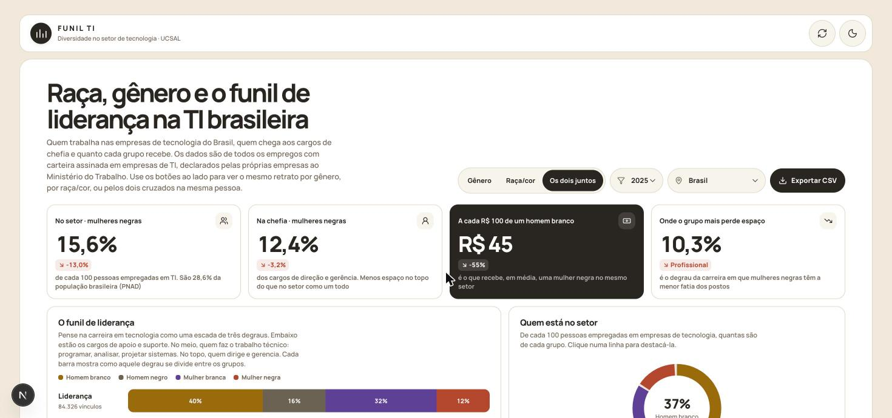
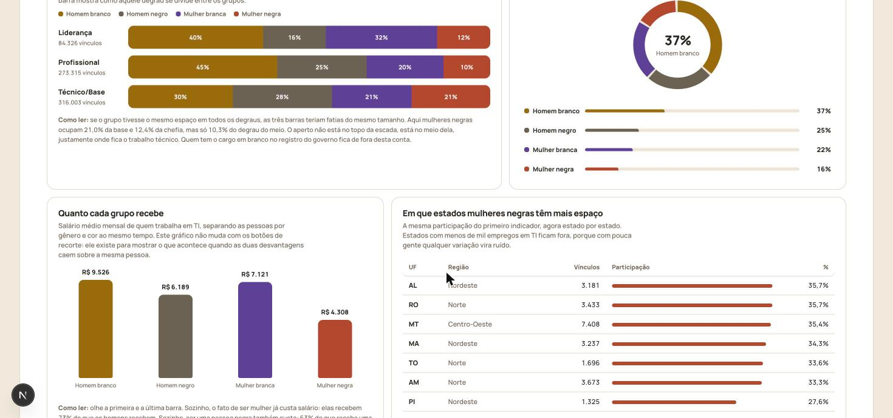

# Diversidade na Tecnologia: Raça, Gênero e o Funil de Liderança no Setor de TI Brasileiro

Projeto prático da disciplina Big Data e Analytics, UCSAL 2026.2.

**Alunos:** Caio Oliveira Sampaio e Victor Oliveira Santana Silva

O projeto lê os microdados de emprego formal do governo federal, filtra o setor de tecnologia e carrega o resultado tratado num banco em nuvem, para responder quem chega aos cargos de chefia em TI e quanto cada grupo ganha, separando por sexo e raça/cor. Alinhamento com as ODS 5 (Igualdade de Gênero) e 18 (Igualdade Étnico-Racial).

```
  FTP público do PDET / Ministério do Trabalho
  RAIS 2025 (7 arquivos .7z)   Novo CAGED 2025 (12 arquivos .7z)
                     │
                     ▼
         etl/download.py        baixa com retomada
         etl/extract_filter.py  descompacta em fluxo, filtra CNAE 62/63
                     │
                     ▼
              Parquet local (data/processed/)
                     │
                     ▼
         etl/transform.py       limpa, tipa, harmoniza, agrega
                     │
                     ▼
              Parquet tratado (data/curated/)
                     │
                     ▼
         etl/load.py            carga via COPY + junção com dimensões
                     │
                     ▼
    Aiven PostgreSQL 18 (free tier, 1 GB)
      esquema dw        10 dimensões + 2 fatos
      esquema publico   6 views com supressão de privacidade
                     │
                     ▼
         dashboard/            Next.js, consulta as views a cada acesso
                     │
                     ▼
              Painel publicado na Vercel
```

## Dados utilizados

### Fonte

Microdados do PDET, o Programa de Disseminação das Estatísticas do Trabalho, ligado ao Ministério do Trabalho e Emprego. Distribuição por FTP público, sem necessidade de cadastro, sob a Lei de Acesso à Informação.

```
ftp.mtps.gov.br/pdet/microdados/RAIS/2025/
ftp.mtps.gov.br/pdet/microdados/NOVO CAGED/2025/{AAAAMM}/
```

### Identificação das bases

A **RAIS** (Relação Anual de Informações Sociais) é uma declaração obrigatória que toda empresa entrega ao governo listando seus empregados com carteira assinada. Cada linha é um vínculo de emprego. Usamos a versão de vínculos, pública, que vem sem identificação pessoal.

O **Novo CAGED** (Cadastro Geral de Empregados e Desempregados) registra as contratações e demissões de cada mês, alimentado pelo eSocial desde 2020. Cada linha é uma movimentação.

### Período

Ano-base 2025 na RAIS e as doze competências de 2025 no CAGED. É o ano mais recente publicado nas duas bases, e o mesmo intervalo nas duas permite comparar estoque com movimentação.

### Características relevantes

| | RAIS 2025 | Novo CAGED 2025 |
|---|---|---|
| Arquivos | 7 `.7z`, um por região | 12 `.7z`, um por mês |
| Tamanho | 3,6 GB compactados | 617 MB compactados |
| Linhas | 91.710.262 | 51.386.117 |
| Formato interno | `.COMT`, separador vírgula, Latin-1, decimal com ponto | `.txt`, separador `;`, UTF-8, decimal com vírgula |
| Granularidade | um vínculo de emprego por linha | uma admissão ou demissão por linha |

Três características pesaram nas decisões técnicas. A primeira é o volume: 143 milhões de linhas somadas, que descompactadas passam de 40 GB, contra 1 GB de banco disponível. A segunda é que a RAIS mudou de layout três vezes no histórico, com separador e decimal diferentes em cada geração, o que exige um leitor por período. A terceira é que as duas bases codificam as mesmas categorias com números diferentes, assunto da próxima seção.

## Tratamento realizado

### Problemas identificados na base

**Códigos que colidem entre as bases.** A RAIS numera raça/cor como 2 branca, 4 preta, 8 parda; o CAGED usa a ordem do IBGE, com 1 branca, 2 preta, 3 parda. Sexo também difere: mulher é 2 na RAIS e 3 no CAGED. Carregar os dois sem traduzir trocaria categorias sem gerar erro nenhum.

**Ausência disfarçada de número.** Os arquivos não deixam campo vazio. Escrevem `9997`, `999999`, `999997` ou textos como `{ñ class}`. Sem tratamento, esses valores entram nas médias como se fossem salário.

**Códigos que parecem número e não são.** Ocupação (CBO, 6 dígitos), ramo de atividade (CNAE, 7 dígitos) e município (IBGE, 7 dígitos) têm zero à esquerda, que some se o campo for lido como inteiro.

**Inconsistências de preenchimento.** Jornada acima de 44 horas, que não existe na lei, e jornada zero, que é campo em branco.

**Decimal com vírgula e zeros à esquerda** nos valores monetários até 2022, e decimal com ponto a partir de 2023.

### Decisões e transformações

| Decisão | O que fizemos | Por quê |
|---|---|---|
| Filtrar durante a leitura | Descompactar o `.7z` em fluxo, ler em blocos de 500 mil linhas e guardar só CNAE 62/63 | O arquivo descompactado passa de 40 GB e não cabe em disco |
| Ler tudo como texto | `dtype=str` e conversão explícita por coluna | Preserva o zero à esquerda dos códigos |
| Agregar antes de carregar | Guardar totais por combinação de dimensões, não pessoa por pessoa | Resolve o limite de 1 GB e a LGPD ao mesmo tempo |
| Guardar soma e contagem | Além da média, gravar `soma_remuneracao` e `qtd_com_remuneracao` | Média não é agregável entre recortes |
| Calcular mediana no ETL | Mediana, p25 e p75 saem do Pandas, não do banco | Não dá para recompor mediana a partir de dados agregados |
| Harmonizar os domínios | Traduzir RAIS e CAGED para um código canônico único | Os códigos colidem com significados diferentes |
| Traduzir na carga, por junção | O `INSERT` junta o staging com as dimensões | Código fora do domínio derruba a carga em vez de entrar errado |
| Nível de liderança derivado | Primeiro dígito da CBO: 1 chefia, 2 profissional, resto base | Permite medir o funil sem guardar a ocupação completa |
| Criar nível "Não classificado" | CBO inválido fica fora do funil | `999999` cairia em "base" e inflaria a variável do estudo |
| Suprimir células pequenas | Views públicas escondem combinações com menos de 5 pessoas | Evita reidentificação em cruzamento fino |

Os critérios de inclusão e exclusão aplicados, com a contagem de cada corte, estão no documento [Etapa 2 Criterios de Inclusao e Exclusao](Etapa%202%20Criterios%20de%20Inclusao%20e%20Exclusao%20-%20v2.pdf). Em resumo: 143.096.379 linhas lidas, 1.760.634 do setor de TI, 1.306.010 válidos depois da limpeza e 198.436 linhas agregadas no banco.

### Conferência

Comparamos entrada e saída em cada etapa. Os vínculos no banco somam 696.587, igual ao que o ETL limpou. Admissões mais demissões dão 609.423, também igual. Das 198.436 linhas agregadas, todas encontraram par nas dimensões.

## Modelagem

### Estrutura do banco

Modelo estrela, dividido em dois esquemas. O `dw` guarda 10 dimensões e 2 tabelas-fato, e é interno. O `publico` tem 6 views que aplicam a supressão de privacidade, e é o que o painel consulta.

```
                      dim_tempo
                          │
   dim_uf ─────┐          │          ┌───── dim_sexo
               │          │          │
  dim_setor ───┼──  fato_vinculo_ti ─┼───── dim_raca_cor
               │          e          │
dim_nivel_ ────┤  fato_movimentacao_ ┼───── dim_faixa_etaria
  lideranca    │         ti          │
               └─────────────────────┴───── dim_escolaridade
```

| Tabela | Linhas | Tamanho | Conteúdo |
|---|---:|---:|---|
| `fato_movimentacao_ti` | 161.058 | 26 MB | admissões e demissões por mês |
| `fato_vinculo_ti` | 37.378 | 7,6 MB | estoque de empregos em 31/12 |
| `dim_tempo` | 144 | 120 kB | meses de 2015 a 2026 |
| `dim_uf` | 28 | 112 kB | estados e regiões |
| `dim_escolaridade` | 12 | 80 kB | do analfabeto ao doutorado |
| `dim_setor` | 10 | 80 kB | as 10 subclasses CNAE de TI |
| `dim_faixa_etaria` | 9 | 80 kB | de 10 a 14 até 65 ou mais |
| `dim_raca_cor` | 7 | 80 kB | ordem do IBGE |
| `dim_nivel_lideranca` | 4 | 80 kB | chefia, profissional, base, não classificado |
| `dim_sexo` | 3 | 80 kB | masculino, feminino, não identificado |
| Total | 198.436 | 43 MB | 4,2% do limite de 1 GB |

### Estratégia de organização dos dados

Escolhemos banco relacional porque o dado é tabular, tem esquema fixo e as consultas do painel são agregações com filtro cruzado. Um banco não relacional resolveria melhor busca textual ou documento aninhado, que não é o caso.

Dentro do relacional, a estrela ganha do modelo normalizado porque cada filtro do painel vira uma junção simples com uma tabela pequena, coisa que o PostgreSQL resolve rápido mesmo no plano gratuito. Como quase não há escrita depois da carga, a redundância da estrela não atrapalha.

O grão dos dois fatos é `ano ou competência × UF × subclasse CNAE × nível de liderança × sexo × raça/cor × faixa etária × escolaridade`. Testamos quatro granularidades antes de fechar essa. Todas cabiam em 1 GB, então o critério de decisão foi outro: no grão mais fino, município cruzado com ocupação específica, só 12% das linhas sobreviveriam à supressão de privacidade, contra 59,5% na escolhida.

Os dois fatos apontam para as mesmas dimensões, o que permite comparar estoque e fluxo no mesmo recorte.

### Representação da modelagem

O DDL completo está em [`sql/01_schema.sql`](sql/01_schema.sql), com `COMMENT ON` em todas as tabelas e colunas. O dicionário de dados em [`docs/dicionario/dicionario-de-dados.md`](docs/dicionario/dicionario-de-dados.md) tem as 131 colunas e é gerado por consulta aos comentários do próprio banco.

A chave primária de cada fato é a combinação das 8 dimensões, então o banco recusa linha duplicada no mesmo recorte. Cada fato tem chave estrangeira para as 8 dimensões.

## Infraestrutura

### Serviços utilizados

| Serviço | Papel no projeto |
|---|---|
| Aiven for PostgreSQL | banco de dados gerenciado, plano gratuito |
| Vercel | hospedagem do dashboard e do cron de keep-alive, plano gratuito |
| FTP do PDET | origem dos microdados |
| GitHub | versionamento do código e da documentação |

### Recursos provisionados

| Recurso | Configuração |
|---|---|
| Serviço | `ti-diversidade-pg` |
| Projeto Aiven | `ucsal-bigdata-2026` |
| Plano | `free-1-1gb`, com 1 GB de armazenamento |
| Nuvem e região | DigitalOcean, `sfo` |
| Versão | PostgreSQL 18 |
| Acesso | internet pública, com TLS obrigatório |
| Banco lógico | `defaultdb` (usado na carga) e `diversidade_ti` |

O provisionamento está descrito como código em [`terraform/`](terraform/), com o provider oficial do Aiven. O serviço em uso foi criado pelo painel durante esta etapa, e os arquivos reproduzem a mesma configuração, incluindo região, plano e versão.

```
terraform/main.tf                    recursos aiven_pg e aiven_pg_database
terraform/variables.tf               parâmetros, com o token marcado como sensível
terraform/outputs.tf                 host, porta e string de conexão
terraform/terraform.tfvars.example   modelo de preenchimento, sem valores reais
```

### Infraestrutura do dashboard

A camada de visualização exigiu hospedagem própria, porque o navegador não conversa
com PostgreSQL diretamente e é preciso um servidor no meio. Ela roda na Vercel, no
plano gratuito, a partir da pasta `dashboard/` deste mesmo repositório.

| Recurso | Configuração |
|---|---|
| Framework | Next.js 16, App Router |
| Root directory | `dashboard` |
| Funções | `/` e `/api/dados`, renderizadas sob demanda |
| Variáveis | `PGHOST`, `PGPORT`, `PGDATABASE`, `PGUSER`, `PGPASSWORD` |
| Cron | `/api/keep-alive`, a cada dois dias às 9h |

O deploy está automatizado em [`dashboard/deploy.sh`](dashboard/deploy.sh), que roda o
build, autentica na Vercel, envia as cinco variáveis de ambiente para os três ambientes
e publica. A declaração do cron fica em `dashboard/vercel.json`, versionada junto do
código.

O cron existe por um motivo concreto: o plano gratuito do Aiven desliga o serviço depois
de algumas semanas sem conexão, e isso aconteceu três vezes ao longo do projeto. Com um
dashboard publicado, uma hibernação significaria a página fora do ar sem aviso. A rota
`/api/keep-alive` abre uma conexão trivial com o banco, o que basta para o Aiven contar
o serviço como em uso.

Quando mesmo assim o banco estiver fora, o painel não quebra: a API distingue falha de
rede de erro de consulta e a interface mostra um aviso explicando que o serviço está
hibernando, com o caminho para religá-lo no console.

### Tecnologias empregadas

Python 3.14 com Pandas para o ETL, PyArrow para escrever Parquet, psycopg2 para a carga, 7-Zip de linha de comando para descompactar em fluxo, PostgreSQL 18 como banco, Terraform para a infraestrutura e Git para versionamento.

No dashboard, Next.js 16 com TypeScript, `pg` para falar com o banco, GSAP para as
animações de entrada e Lucide para os ícones. Os gráficos são SVG escrito à mão, sem
biblioteca de visualização: o funil precisa de barras empilhadas com número variável de
categorias, e as bibliotecas prontas que avaliamos assumiam séries de tamanho fixo.

A leitura é feita em blocos com `pandas.read_csv(chunksize=...)`, que mantém o uso de memória constante independente do tamanho do arquivo. A carga usa `COPY` em vez de `INSERT`, o que faz diferença grande no volume que carregamos.

## Segurança das informações

Nenhuma credencial, senha, token ou chave está no repositório.

**Credenciais do banco.** Ficam em um arquivo `.env` na raiz, que está no `.gitignore` e nunca foi versionado. O [`.env.example`](.env.example) mostra quais variáveis existem, com os valores em branco. O `etl/load.py` lê a conexão com `python-dotenv` e falha com mensagem clara se alguma variável estiver faltando, em vez de tentar conectar com valor padrão.

**Token da API do Aiven.** Usado só pelo Terraform, vem de variável de ambiente (`TF_VAR_aiven_api_token`) e está declarado como `sensitive = true`, o que impede o valor de aparecer no log do `apply`. O `terraform.tfvars` real está no `.gitignore`; o repositório leva só o `.example`.

**Estado do Terraform.** Os arquivos `.tfstate` guardam credenciais em texto claro e também estão no `.gitignore`.

**Dados pessoais.** Usamos a versão pública dos microdados, que já vem sem CPF, PIS, nome e data de nascimento. O ETL ainda descarta as colunas de bairro e distrito, que funcionam como quase-identificadores quando combinadas com ocupação e faixa salarial. No banco, as tabelas com o dado completo ficam no esquema interno e as views públicas suprimem qualquer combinação com menos de 5 pessoas. O efeito é grande: das 37.378 linhas do fato de vínculos, 13.239 aparecem na view pública, e das 161.058 do fato de movimentações, 29.087.

**Separação de privilégio.** O schema cria o papel `dashboard_leitura` com permissão apenas de leitura sobre o esquema `publico`. Ele é criado sem login e sem senha de propósito, para que nenhuma credencial fique versionada; quem for usar define a senha no momento de conceder o acesso.

**Credenciais do dashboard.** A aplicação publicada usa esse mesmo `dashboard_leitura`, e não o administrador do banco. A credencial vive nas variáveis de ambiente do projeto na Vercel e, localmente, em `dashboard/.env.local`, que o `.gitignore` cobre e que nunca entrou em nenhum commit. Mesmo que alguém obtenha a credencial a partir do servidor, só alcança as views já suprimidas do esquema `publico`: não lê o esquema `dw` e não escreve nada.

**Superfície exposta pelo dashboard.** As consultas ficam no servidor, não no navegador. O cliente recebe JSON já agregado e nunca envia SQL, então não existe caminho para injeção a partir da interface. Os únicos parâmetros aceitos pela API são ano e UF, ambos passados como parâmetros ligados da consulta e não concatenados no texto do SQL. O ano é convertido para número e descartado se não for finito; a UF entra como texto comparado contra a coluna, de modo que um valor inventado simplesmente não casa com nenhuma linha.

## Execução

### Ferramentas e dependências

- Python 3.11 ou mais novo
- 7-Zip de linha de comando (`7zz`). No macOS, `brew install sevenzip`
- Terraform 1.5 ou mais novo, caso queira provisionar o banco por código
- Cerca de 10 GB livres em disco para os arquivos baixados
- Uma conta no Aiven com um serviço PostgreSQL

Pacotes Python: `pandas`, `pyarrow`, `psycopg2-binary` e `python-dotenv`.

### Informações necessárias para reprodução

O `.env` precisa de `PGHOST`, `PGPORT`, `PGDATABASE`, `PGUSER`, `PGPASSWORD` e `PGSSLMODE`. Esses valores vêm do painel do Aiven, na aba Overview do serviço, ou do comando `terraform output -raw service_uri`.

O Terraform precisa de `TF_VAR_aiven_api_token`, gerado em User settings → Authentication, e de `TF_VAR_aiven_project` com o nome do projeto.

### Sequência de execução

```bash
# 1. ambiente
python3 -m venv .venv
.venv/bin/pip install pandas pyarrow psycopg2-binary python-dotenv

# 2. credenciais
cp .env.example .env
# preencher com os dados do serviço

# 3. provisionar o banco, se ainda não existir
cd terraform
export TF_VAR_aiven_api_token="seu-token"
export TF_VAR_aiven_project="seu-projeto"
terraform init && terraform apply
terraform output -raw service_uri    # para preencher o .env
cd ..

# 4. baixar os microdados (demora, são 4,2 GB)
.venv/bin/python etl/download.py rais 2025
.venv/bin/python etl/download.py caged 2025

# 5. filtrar o setor de TI
.venv/bin/python etl/extract_filter.py rais  data/raw/rais/2025/*.7z
.venv/bin/python etl/extract_filter.py caged data/raw/caged/2025/*.7z

# 6. tratar e agregar
.venv/bin/python etl/transform.py rais  data/processed/rais/2025/*.parquet
.venv/bin/python etl/transform.py caged data/processed/caged/2025/*.parquet

# 7. criar as tabelas e carregar
.venv/bin/python etl/load.py --schema --fatos --stats
```

O último comando imprime quantas linhas entraram em cada tabela e quanto o banco está ocupando. As consultas de [`sql/02_consultas_exemplo.sql`](sql/02_consultas_exemplo.sql) reproduzem os resultados apresentados na documentação.

Os passos 4 e 5 podem ser pulados: a base já tratada está em `data/export/` em CSV e em `data/curated/` em Parquet, então dá para ir direto ao passo 7.

## Organização das pastas

```
etl/        scripts do pipeline
sql/        estrutura do banco e consultas de exemplo
terraform/  infraestrutura como código
dashboard/  aplicação de visualização (Next.js)
docs/       dicionário de dados e imagens do painel
data/       base tratada em CSV e Parquet
```

Os arquivos baixados e os intermediários ficam em `data/raw/` e `data/processed/`, fora do controle de versão por causa do tamanho.

## Dashboard

**Acesso:** PLACEHOLDER_LINK

Para rodar na sua máquina, depois de preencher `dashboard/.env.local` com a credencial
de leitura que está em `acesso-leitura.txt`:

```bash
cd dashboard && npm run local
```

O comando instala as dependências, confere o arquivo de ambiente e sobe o painel em
`http://localhost:3000`. Instruções de publicação em [`dashboard/README.md`](dashboard/README.md).





### Como ele conversa com o banco

O navegador não fala PostgreSQL, então existe uma camada de API no meio. Cada acesso
ao painel dispara uma rota no servidor da Vercel, que abre conexão com o PostgreSQL da
Aiven, consulta as views do schema `publico` e devolve o resultado agregado em JSON.
Não há cópia dos dados dentro da aplicação: desligar o banco derruba o painel, o que é
a prova de que a consulta é mesmo ao vivo.

O usuário usado é o `dashboard_leitura`, que só enxerga o schema `publico` e não
escreve. Mesmo que alguém consiga a credencial a partir do servidor, não alcança as
tabelas do schema `dw` nem altera nada.

### Os quatro indicadores

Os três primeiros botões do painel escolhem o recorte: gênero, raça/cor, ou os dois
cruzados na mesma pessoa. Os indicadores respondem ao recorte escolhido, de modo que no
modo cruzado todos os quatro passam a ser interseccionais.

**No setor.** Percentual que o grupo ocupa entre todos os empregos de TI. É a linha de
base de tudo o mais: sem saber quanto espaço o grupo tem no setor, nenhum número sobre
chefia ou salário tem com o que ser comparado. Cada valor vem acompanhado da proporção
do mesmo grupo na população brasileira, segundo a PNAD, para separar o que é
sub-representação no setor do que é composição do país. Mulheres são 37,8% do setor e
51,5% da população; mulheres negras, 15,6% contra 28,6%.

**Na chefia.** O mesmo percentual, agora só entre os cargos de direção e gerência. Lido
contra o indicador anterior, mostra se o grupo mantém, ganha ou perde espaço ao subir.
Mulheres negras são 15,6% do setor e 12,4% da chefia.

**A cada R$ 100 de um homem branco.** Quanto recebe, em média, uma mulher negra no mesmo
setor: R$ 45. Este é o único indicador que não muda com o recorte, de propósito. Ele
existe para manter visível o cruzamento das duas desigualdades mesmo quando o usuário
está olhando gênero ou raça isoladamente.

**Onde o grupo mais perde espaço.** Entre os três degraus da carreira, aquele em que o
grupo tem a menor fatia dos postos. Para pessoas negras é a chefia, com 27,5%. Para
mulheres e para mulheres negras é o degrau profissional, com 30,5% e 10,3%, e essa
diferença entre os recortes é o achado mais interessante do projeto.

### Filtros

Recorte da análise, com três modos: gênero, raça/cor, e os dois cruzados. Ano de
referência. Unidade da federação, com as 27 ou o Brasil inteiro.

Ano e UF vão ao banco e refazem a consulta. O recorte é recálculo no navegador, porque
a API já devolve as linhas abertas por degrau, sexo e raça/cor, e refazer a consulta
para trocar de recorte seria desperdício.


## O que os dados mostram

Os números abaixo saem das views do banco para 2025, sobre os 695.978 vínculos que
passam pela supressão de privacidade. Eles são a resposta do projeto às duas ODS.

### A desigualdade racial tem o formato clássico de funil

| Degrau | Pessoas brancas | Pessoas negras |
|---|---:|---:|
| Liderança | 70,6% | 27,5% |
| Profissional | 63,7% | 34,2% |
| Técnico/Base | 50,4% | 48,3% |

A base do setor é quase equilibrada. A cada degrau que se sobe, a participação negra
cai, e no topo ela é pouco mais da metade do que era embaixo. O índice de afunilamento,
que divide a participação na liderança pela participação na base, fica em 0,57.

Isso é o que a ODS 18 prevê e o dado confirma sem ambiguidade: o problema não é o
acesso ao setor, é a progressão dentro dele.

### A desigualdade de gênero tem outro formato, e esse foi o achado inesperado

| Degrau | Mulheres |
|---|---:|
| Liderança | 44,2% |
| Profissional | 30,5% |
| Técnico/Base | 42,3% |

Se olhássemos só o topo e a base, concluiríamos que não há teto de vidro em TI, porque
a participação feminina na liderança (44,2%) é maior que na base (42,3%). O índice de
afunilamento daria 1,05 e o relatório terminaria aqui, errado.

O estrangulamento está no meio. O degrau profissional, que pela CBO concentra os
analistas, desenvolvedores e demais ocupações técnicas qualificadas, tem 30,5% de
mulheres, quase doze pontos abaixo da base.

Uma leitura plausível é que mulheres entram em empresas de TI principalmente por
funções administrativas, de atendimento e de gestão, e não pelas funções técnicas. Isso
explicaria tanto a base alta quanto a liderança alta: a chefia medida aqui é o grande
grupo 1 da CBO inteiro, que inclui gerência administrativa, comercial e de pessoas, não
apenas liderança técnica.

Essa é uma hipótese, não uma conclusão. Para confirmá-la seria preciso abrir o CBO em
famílias de quatro dígitos em vez do grande grupo, e separar a gerência de TI das
demais gerências. O grão atual do banco não permite isso, e inventar a conclusão a
partir do dado que temos seria ir além do que ele sustenta.

De todo modo, a implicação para a ODS 5 muda. Política de promoção de mulheres a cargos
de chefia não resolveria o gargalo observado, porque o gargalo não está lá. Ele está na
entrada da carreira técnica.

### Cruzando os dois recortes, aparece o que nenhum deles mostrava sozinho

Participação de cada grupo em cada degrau, em percentual da linha:

| Degrau | Homem branco | Homem negro | Mulher branca | Mulher negra |
|---|---:|---:|---:|---:|
| Liderança | 40,0% | 15,6% | 32,0% | 12,4% |
| Profissional | 44,8% | 24,7% | 20,3% | 10,3% |
| Técnico/Base | 29,7% | 27,9% | 21,4% | 21,0% |

A base é quase equilibrada entre os quatro grupos. A partir dali cada um segue um
caminho diferente, e os caminhos não se parecem.

Homens brancos ganham espaço já no degrau técnico, saltando de 29,7% para 44,8%.
Mulheres negras fazem o inverso no mesmo ponto, caindo de 21,0% para 10,3%, e não
recuperam no topo. Homens negros perdem espaço de forma contínua, de 27,9% até 15,6%.
Mulheres brancas são o único grupo que perde no meio e recupera em cima, indo de 21,4%
na base a 32,0% na liderança.

Esse último contraste é o resultado mais desconfortável do projeto. Na chefia das
empresas de TI, mulheres brancas ocupam 32,0% dos postos e homens negros 15,6%, o dobro.
Em um setor onde homens são a maioria, isso indica que a cor pesa mais que o gênero no
acesso aos cargos de direção, e que tratar "mulheres" e "pessoas negras" como dois
blocos homogêneos esconde quem de fato está ficando de fora.

Vale dizer o que esse número não prova. Ele descreve a composição dos cargos, não o
processo que levou a ela, e a chefia medida aqui inclui gerência administrativa,
comercial e de pessoas, não apenas liderança técnica. Pode ser que mulheres brancas
estejam concentradas em gerências de área e homens negros em funções técnicas sem
cargo de gestão. Verificar isso exigiria abrir o CBO em famílias de quatro dígitos, o
que o grão atual do banco não permite.

### As duas desigualdades se multiplicam

| | Pessoas brancas | Pessoas negras |
|---|---:|---:|
| Homens | R$ 9.526 | R$ 6.189 |
| Mulheres | R$ 7.121 | R$ 4.308 |

Isoladamente, mulheres recebem 73,1% do salário masculino e pessoas negras recebem
63,4% do salário de pessoas brancas. Se os dois efeitos fossem independentes e se
compusessem por multiplicação, uma mulher negra receberia 46,4% do que recebe um homem
branco. O valor observado é 45,2%.

A proximidade entre o previsto e o observado é o resultado mais concreto do projeto:
gênero e raça não se somam, se multiplicam, e ainda há uma penalidade adicional de
pouco mais de um ponto que nenhum dos dois recortes isolados explica. É exatamente por
isso que ODS 5 e ODS 18 precisam ser analisadas juntas e não em relatórios separados.

### O fluxo de contratações sugere movimento

| | Composição atual | Entre as admissões de 2025 |
|---|---:|---:|
| Mulheres | 37,8% | 40,1% |
| Pessoas negras | 39,9% | 46,3% |

O setor está contratando mais diverso do que já é, principalmente no recorte racial, em
que a diferença passa de seis pontos. Mantida essa proporção, a composição do estoque
tende a se aproximar da composição das admissões ao longo dos anos.

Com um único ano carregado não dá para afirmar que isso é tendência, porque não há série
histórica para comparar. É uma leitura do momento, e carregar os anos anteriores da RAIS
pelo mesmo pipeline é o passo natural para verificá-la.

### Limites que o leitor precisa conhecer

Tudo aqui descreve o emprego formal com carteira assinada nas divisões 62 e 63 da CNAE.
Pessoa jurídica, trabalho informal e profissionais de TI empregados em empresas de outros
setores, como um banco ou uma indústria, ficam de fora. Em um setor com muita
contratação PJ, isso é uma limitação real do recorte, não um detalhe.

Os percentuais de raça/cor consideram apenas quem declarou. Vínculos sem declaração
existem e aparecem no painel como categoria própria, mas não entram no denominador dos
indicadores, porque misturá-los reduziria todos os percentuais por um motivo que não tem
relação com desigualdade.

E os totais são do universo publicável. A supressão de combinações com menos de cinco
vínculos protege a privacidade, mas remove justamente as células menores, que tendem a
ser as de grupos minoritários em municípios pequenos. A participação de pessoas indígenas
e amarelas, em especial, é subestimada por esse efeito.

## Fontes

- [Microdados da RAIS e do Novo CAGED](http://pdet.mte.gov.br/microdados-rais-e-caged), PDET / Ministério do Trabalho e Emprego
- [Classificação Nacional de Atividades Econômicas (CNAE 2.0)](https://concla.ibge.gov.br/), IBGE
- [Classificação Brasileira de Ocupações (CBO 2002)](http://www.mtecbo.gov.br/), Ministério do Trabalho e Emprego
- [API de Localidades](https://servicodados.ibge.gov.br/api/docs/localidades), IBGE
